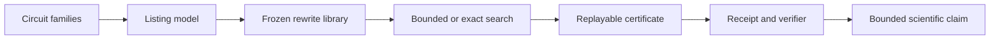

# Quantum Peephole Ceiling

[](https://www.python.org/)
[](LICENSE)
[](docs/PROJECT_STATUS.md)

Quantum Peephole Ceiling studies when a quantum circuit optimizer can see and
apply local rewrites, and when the circuit representation hides those
opportunities. The repository combines executable optimizers, controlled
experiments, frozen datasets, replayable certificates, and independent
verification scripts.


The v14 result was a large engineering improvement over v13: all 18 screening
configurations pass the declared 5% resource threshold, compared with 0 of 18
in v13. Its selected exact finite-horizon run certified 93 of 128 inputs and
left 35 resource-truncated, while a complementary IDA* panel classified all
128 inputs as 63 exact escapes and 65 exact local optima.

The current v16 result closes the classification bookkeeping without rerunning
any frozen search: 93 sources carry exact best-cost quantities, 34 are
witness-bounded and 1 is resource-bounded (127 classified plus one resource
tier). The E46 window-landscape panel adds a position-resolved certified
profile over the same fixed panel: 76,236 window searches with zero
truncations and 39,572 certified escapes. The panel is **two strata and the
rates must be read per stratum**: on the 23 greedy fixed-point roots that have
16-gate windows, 39.71 percent of 481 windows hide a certified escape of depth
at least two, with zero depth-one escapes; on the 50 roots whose normalised
listing exceeds the baseline gate budget, 57.81 percent of 18,274 windows
escape but 97.9 percent of those escapes are depth one. A search-free span
criterion (E72, 2026-10-27) predicts every one of these 76,236 outcomes with
zero false positives and an exact first-escape depth on 99.995 percent of
them; the residual is a rule-library content class, and after Holm-Bonferroni
control (E77, 2026-10-28) it is **family-specific, not structure-generic** —
on greedy fixed points IQP and Oracle windows carry significantly more of it
and RandomClifford/UCCSD significantly less. The price of that incompleteness
is thresholded, not diffuse (E75, 2026-10-28): on enumerable Clifford
fragments, length-2 rules buy exactly 0.00 percent, and the gap collapses
30.25% → 9.12% → 0.00% as the maximal pattern length grows 2 → 3 → 4, with
the 1-qubit Clifford threshold at `L* = 4` against listing length `m = 8`
(`docs/theory/decidability_frontier_2026-10-28.md`, Theorems 5-6).

## What the project does



The project has three connected research layers:

- **Representation sensitivity:** layer-by-layer and wire-consecutive listings
  expose different local action spaces for the same circuits.
- **Optimizer boundaries:** prototype and production compilers are compared
  across circuit families, rewrite models, and resource budgets.
- **Certified search:** v12-v15 add frozen rule libraries, exact or explicitly
  incomplete search, certificate replay, classification-complete landscape
  integration, and fail-closed readiness verdicts.

## Evidence snapshot

| Evidence layer | Result | Current boundary |
|---|---|---|
| E1-E30 canonical benchmark | 96,205 active rows across 35 datasets | Historical release is hash-pinned |
| E31-E37 extensions | Sealed factorial, telemetry, scale, external and cost panels | Reported separately from canonical totals |
| v13 E45 | 0/18 screening configurations eligible | Closed as a recorded resource failure |
| v14 E45 screening | 18/18 eligible; 13,824 rows; 0 semantic failures | Screening optimization complete |
| v14 exact finite horizon | 93 exact; 35 resource-truncated | Enumerated quantities remain bounded for 35 cells |
| v14 IDA* escape depth | 63 exact escapes; 65 exact local optima | Complete for the declared 128-input panel |
| v15 landscape integration | 128/128 classified; 94 exact `best_cost_at_h3`; 34 witness-bounded | Zero unclassified cells; zero replay failures |
| v16 landscape integration | 93 exact `best_cost_at_h3`; 34 witness-bounded; 1 resource-bounded | 127 classified + 1 resource tier (engine repair re-pin) |
| v16 E46 window landscape | 76,236 windows; 39,572 certified escapes; 0 truncations | Two strata: 39.71% (23 greedy roots, 481 w16 windows) vs 57.81% (50 raw roots, 18,274 windows) |
| E75 completeness price | 30.25% → 9.12% → 0.00% as maximal pattern length grows 2 → 3 → 4; 1-qubit Clifford threshold `L* = 4` | Fragment-level only (enumerable optima); width ≥ 3 unmeasured |
| E77 family residual | Holm-controlled residual is family-specific (IQP/Oracle high; RandomClifford/UCCSD low) | Blanket "structured families" claim withdrawn |

`best_cost_at_h3` is the exact best cost reachable within the declared horizon
`h = 3` under rule scope `e44_core_v1`; it is **not** an unconstrained optimum.
A search-free commutation closure reaches a strictly lower cost on 60/128 of the
same sources (see `docs/theory/exposability_criterion_2026-10-23.md`), and
98.2% of that extra reduction is single-qubit gate merging (see
`docs/review/science_boost/2026-10-24_innovation_scan.md`).

The repository is engineering-verified but the v15 scientific verdict remains
`NOT_READY_FOR_PAPER` because enumerated landscape quantities for 34 long-listing
cells and external execution gates have not been established. Paper writing and
GitHub Actions are outside the current project scope.

## Quick start

Python 3.12 is required.

```bash
conda env create -f environment.yml
conda activate q-research
python -m pytest tests/ -q
```

Verify the frozen data and current v14/v15 evidence without rerunning the full
experiment suite:

```bash
python scripts/reproduce_all.py --verify
python scripts/verify_e45_development_grid.py --output-root data/v14/e45_development_grid
python scripts/verify_e45_exact_development.py --output-root data/v14/e45_full_development
python scripts/verify_v14_idastar_escape.py --output-root data/v14/e45_idastar_escape
python scripts/verify_v14_readiness_verdict.py
python scripts/verify_v15_landscape_integration.py
python scripts/verify_e46_window_landscape.py
python scripts/verify_v15_readiness_verdict.py
```

Regenerate the overview figure:

```bash
python scripts/generate_showcase_figure.py
```

## Repository layout

| Path | Purpose |
|---|---|
| `src/` | Reusable circuit and optimization code |
| `experiments/` | Versioned experiment entrypoints |
| `data/` | Canonical, sealed, and bounded evidence packages |
| `analysis/` | Statistical analysis and research figures |
| `scripts/` | Reproduction, verification, and release checks |
| `tests/` | Unit, integration, schema, and evidence tests |
| `docs/` | Current documentation, theory, results, and audit records |
| `release/` | Hash manifests, receipts, and readiness verdicts |

Start with the [project status](docs/PROJECT_STATUS.md),
[experiment history](docs/EXPERIMENT_HISTORY.md),
[documentation map](docs/README.md), and [data guide](data/README.md).

## Reproducibility rules

- Canonical data are controlled by `data/DATA_CANONICAL.md` and
  `release/release_manifest.json`.
- Sealed historical evidence is never rewritten to improve a later result.
- Resource and semantic failures remain visible in receipts.
- A verifier passing supports only the gate that verifier checks.
- Generated summaries and figures can be rebuilt from recorded evidence.

See [docs/reproducibility.md](docs/reproducibility.md) for the complete protocol.

## License and citation

The code is released under the [MIT License](LICENSE). Citation metadata are
available in [CITATION.cff](CITATION.cff).
