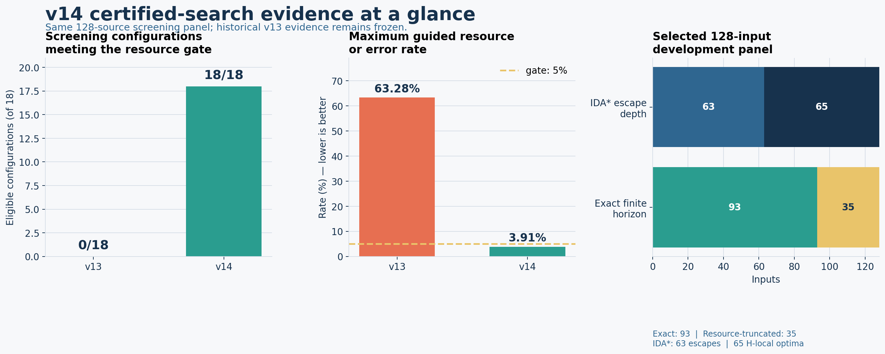
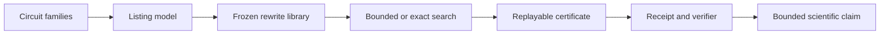

# Quantum Peephole Ceiling

[](https://www.python.org/)
[](LICENSE)
[](docs/PROJECT_STATUS.md)

Quantum Peephole Ceiling studies when a quantum circuit optimizer can see and
apply local rewrites, and when the circuit representation hides those
opportunities. The repository combines executable optimizers, controlled
experiments, frozen datasets, replayable certificates, and independent
verification scripts.



The current v14 result is a large engineering improvement over v13: all 18
screening configurations pass the declared 5% resource threshold, compared
with 0 of 18 in v13. The selected exact finite-horizon run certifies 93 of 128
inputs and records the other 35 as resource-truncated. A complementary IDA*
panel classifies all 128 inputs as 63 exact escapes and 65 exact local optima,
with no resource boundary and no replay failure.

## What the project does



The project has three connected research layers:

- **Representation sensitivity:** layer-by-layer and wire-consecutive listings
  expose different local action spaces for the same circuits.
- **Optimizer boundaries:** prototype and production compilers are compared
  across circuit families, rewrite models, and resource budgets.
- **Certified search:** v12-v14 add frozen rule libraries, exact or explicitly
  incomplete search, certificate replay, and fail-closed readiness verdicts.

## Evidence snapshot

| Evidence layer | Result | Current boundary |
|---|---|---|
| E1-E30 canonical benchmark | 96,205 active rows across 35 datasets | Historical release is hash-pinned |
| E31-E37 extensions | Sealed factorial, telemetry, scale, external and cost panels | Reported separately from canonical totals |
| v13 E45 | 0/18 screening configurations eligible | Closed as a recorded resource failure |
| v14 E45 screening | 18/18 eligible; 13,824 rows; 0 semantic failures | Screening optimization complete |
| v14 exact finite horizon | 93 exact; 35 resource-truncated | Full exact landscape remains open |
| v14 IDA* escape depth | 63 exact escapes; 65 exact local optima | Complete for the declared 128-input panel |

The repository is engineering-verified but the v14 scientific verdict remains
`NOT_READY_FOR_PAPER` because a complete exact landscape and external execution
gates have not been established. Paper writing and GitHub Actions are outside
the current project scope.

## Quick start

Python 3.12 is required.

```bash
conda env create -f environment.yml
conda activate q-research
python -m pytest tests/ -q
```

Verify the frozen data and current v14 evidence without rerunning the full
experiment suite:

```bash
python scripts/reproduce_all.py --verify
python scripts/verify_e45_development_grid.py --output-root data/v14/e45_development_grid
python scripts/verify_e45_exact_development.py --output-root data/v14/e45_full_development
python scripts/verify_v14_idastar_escape.py --output-root data/v14/e45_idastar_escape
python scripts/verify_v14_readiness_verdict.py
```

Regenerate the overview figure:

```bash
python scripts/generate_showcase_figure.py
```

## Repository layout

| Path | Purpose |
|---|---|
| `src/` | Reusable circuit and optimization code |
| `experiments/` | Versioned experiment entrypoints |
| `data/` | Canonical, sealed, and bounded evidence packages |
| `analysis/` | Statistical analysis and research figures |
| `scripts/` | Reproduction, verification, and release checks |
| `tests/` | Unit, integration, schema, and evidence tests |
| `docs/` | Current documentation, theory, results, and audit records |
| `release/` | Hash manifests, receipts, restore capsules, and verdicts |

Start with the [project status](docs/PROJECT_STATUS.md),
[experiment history](docs/EXPERIMENT_HISTORY.md),
[documentation map](docs/README.md), and [data guide](data/README.md).

## Reproducibility rules

- Canonical data are controlled by `data/DATA_CANONICAL.md` and
  `release/release_manifest.json`.
- Sealed historical evidence is never rewritten to improve a later result.
- Resource and semantic failures remain visible in receipts.
- A verifier passing supports only the gate that verifier checks.
- Generated summaries and figures can be rebuilt from recorded evidence.

See [docs/reproducibility.md](docs/reproducibility.md) for the complete protocol.

## License and citation

The code is released under the [MIT License](LICENSE). Citation metadata are
available in [CITATION.cff](CITATION.cff).
